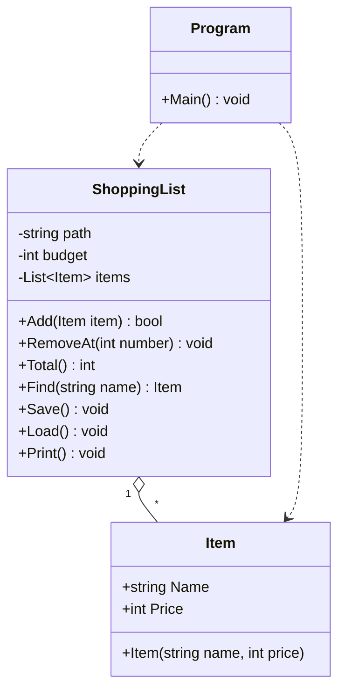

# Robust inköpslista

Konsolprogram i C# där man kan lägga till, ta bort, söka, spara och läsa in varor i en inköpslista. Starta med `dotnet run`.

## Felrapport

| # | Fel | Orsak | Lösning |
|---|-----|-------|---------|
| 1 | Programmet kraschade direkt vid start med `IndexOutOfRangeException` i `Load()` | `items.txt` slutar med en radbrytning, så `Split('\n')` ger en tom sista rad. Den har inget `;`, så `parts[1]` finns inte | `string.IsNullOrWhiteSpace(line)` och `continue` hoppar över tomma rader |
| 2 | Totalsumman blev 121 kr i stället för 136 kr (ingen krasch, bara fel svar) | `for`-loopen i `Total()` startade på `i = 1`, så första varan (plats 0) räknades aldrig med | Loopen startar på `i = 0` |
| 3 | Programmet kraschade med `ArgumentOutOfRangeException` när jag tog bort en vara med ett nummer som inte finns | `RemoveAt(number - 1)` kördes utan att kontrollera att numret fanns i listan | `if (number >= 1 && number <= items.Count)` innan varan tas bort |
| 4 | Programmet kraschade med `FormatException` när jag skrev text i menyn, som pris eller som nummer | `int.Parse` kastar undantag när texten inte är ett heltal | `int.TryParse`, meddelande "Använd siffror." och `continue` tillbaka till menyn |
| 5 | En vara som syntes i listan hittades inte när jag sökte på namnet, och namnen från filen syntes inte i utskriften | Filen har radbrytningen `\r\n`, men `Load()` delar på `\n`, så namnet blev `Mjölk\r` i stället för `Mjölk` | `.Trim()` på namnet i `Load()` |
| 6 | `Save()` dolde fel och skrev "Listan är sparad" även när det misslyckades | Tom `catch` och meddelandet låg utanför `try` | Meddelandet ligger i `try`. Specifika `catch` för `IOException` och `UnauthorizedAccessException` skriver ut felet |
| 7 | Programmet kraschade med `FileNotFoundException` om `items.txt` saknades | `File.ReadAllText` kastar undantag när filen inte finns | `File.Exists` kontrolleras först. Saknas filen börjar listan tom |

## Designval

- **`Item` kastar undantag.** `ArgumentException` vid tomt namn och `ArgumentOutOfRangeException` vid negativt pris. En konstruktor kan inte returnera `false`, och ett ogiltigt objekt ska aldrig kunna skapas.
- **`ShoppingList.Add` returnerar `bool`** i stället för att kasta undantag. Att en vara inte ryms inom budgeten är ett väntat läge i vanlig användning, inte ett programmeringsfel. Anroparen får svaret direkt och kan visa ett tydligt meddelande utan `try/catch`.
- **Budgettaket** ligger i `ShoppingList` (standard 500 kr), eftersom det är listan som känner till totalsumman.
- **`Program.cs` hanterar båda fallen:** `ArgumentException` fångas vid skapandet av varan, och `false` från `Add` ger ett meddelande. Programmet fortsätter i båda fallen.
- **`int.TryParse`** används för all inmatning så att text aldrig kraschar programmet.
- **Specifika `catch`** används i stället för `Exception`, och inga `catch`-block är tomma.
- **Felaktiga rader i `items.txt`** hoppas över med ett meddelande i `Load()` i stället för att stoppa programmet.

## Klassdiagram

